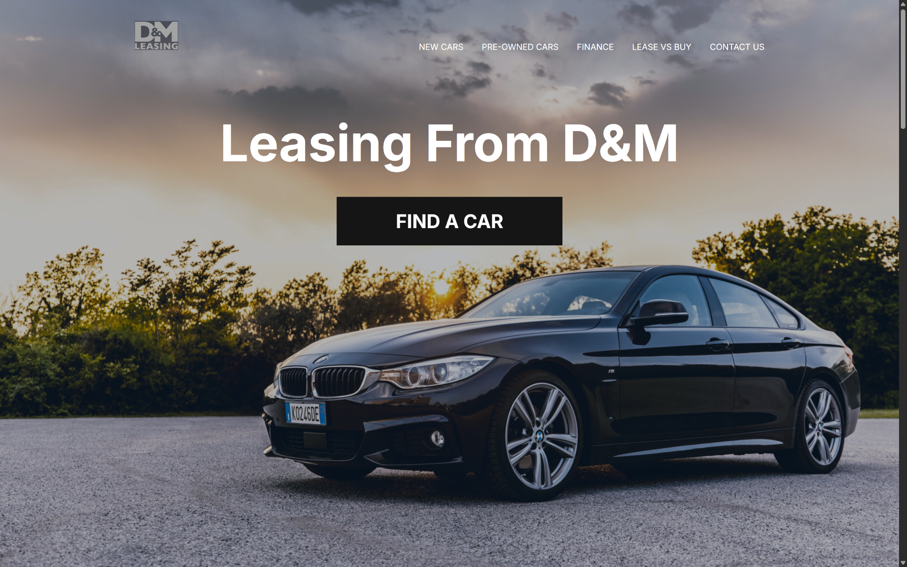
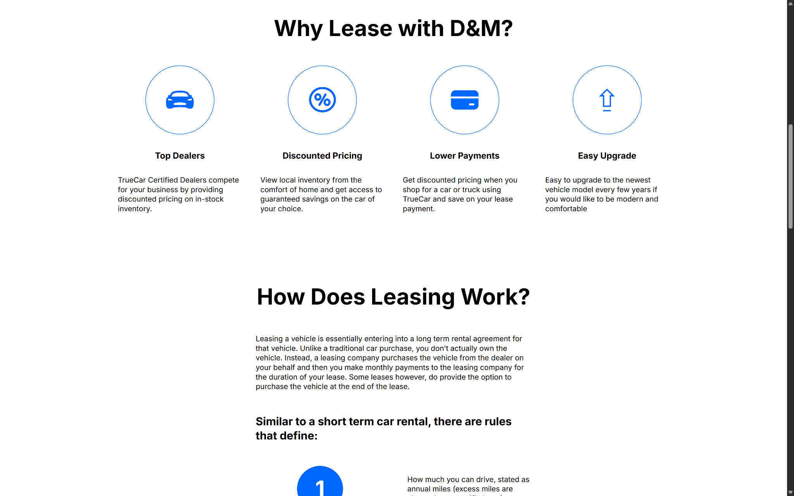
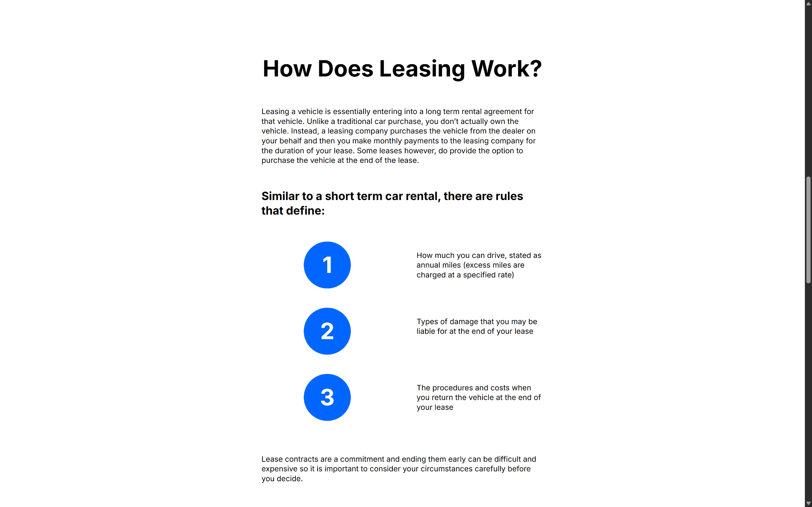
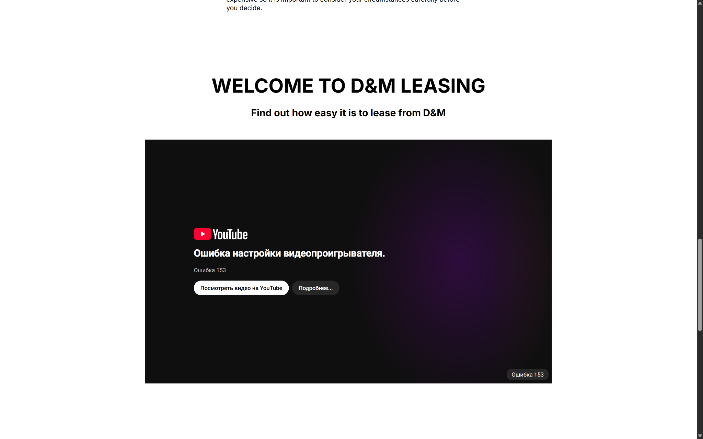
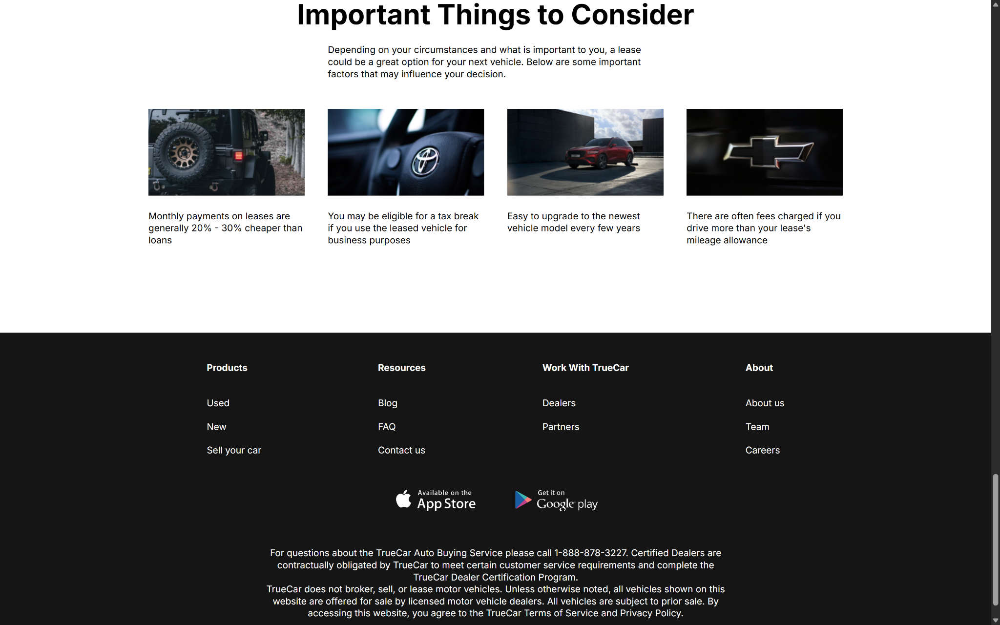
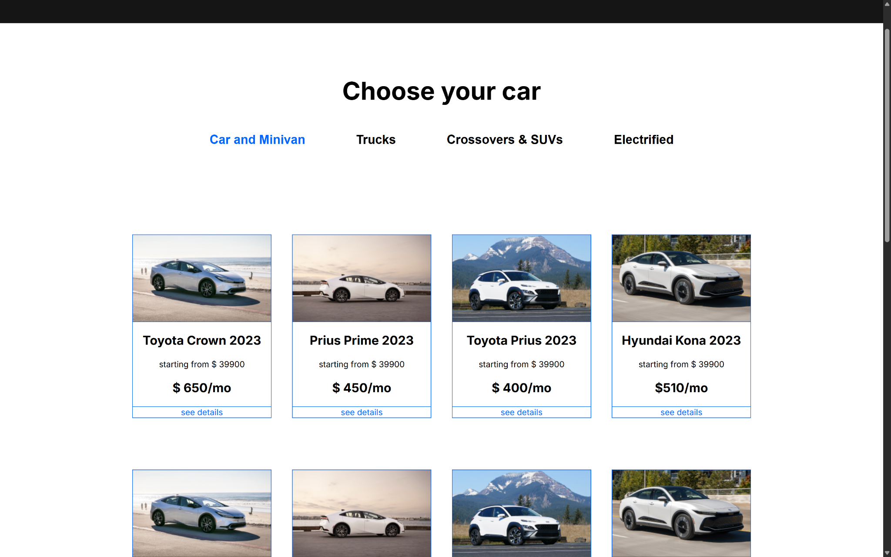
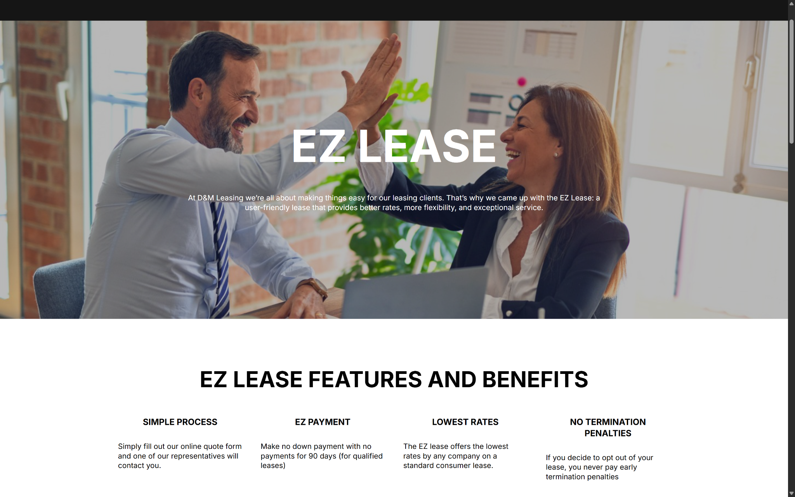
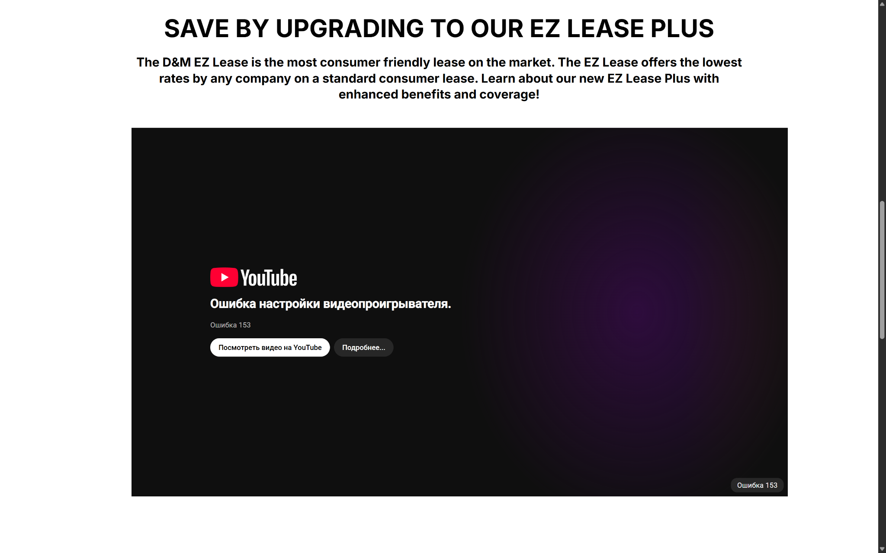
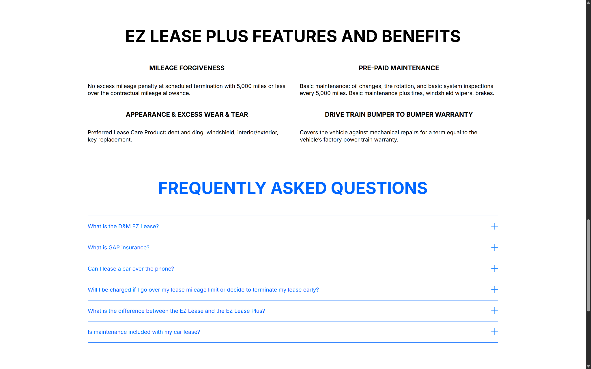
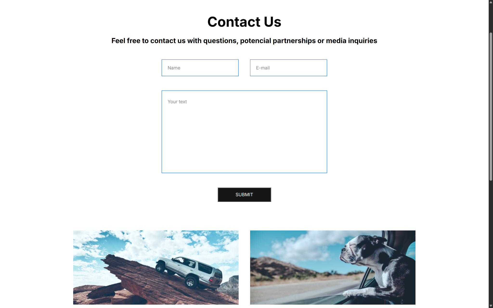

# D&M Leasing — учебная вёрстка

Учебный проект автомобильного сайта, выполненный по видеоуроку на YouTube для практики HTML и CSS.

В процессе работы я учился создавать страницы из отдельных секций, размещать изображения, оформлять карточки автомобилей, навигацию, FAQ и форму обратной связи.

## Скриншоты

Ниже представлены скриншоты учебной страницы.

## О проекте

Это практическая работа по вёрстке. Дизайн и структура создавались по обучающему видео.
